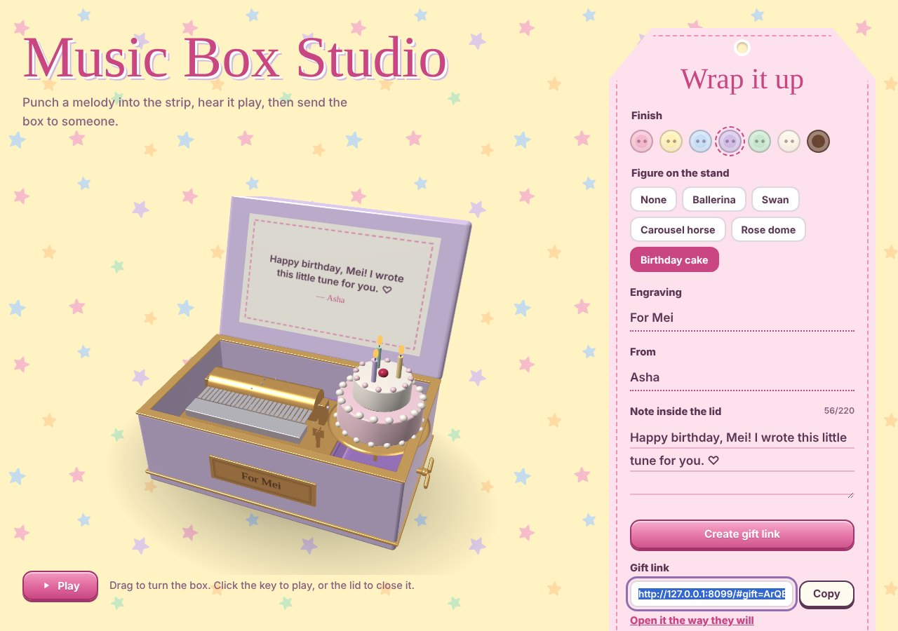
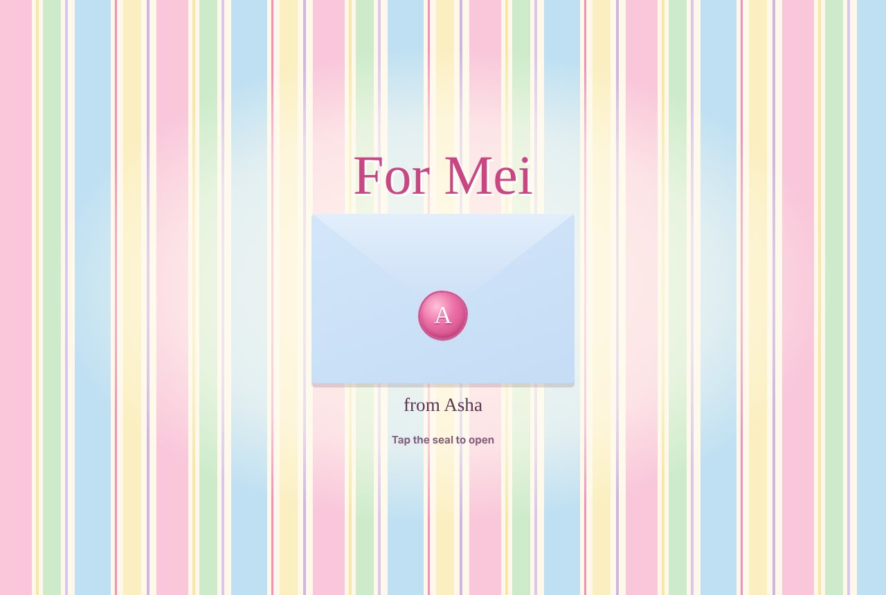
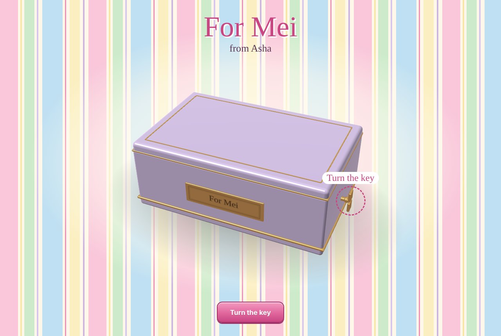
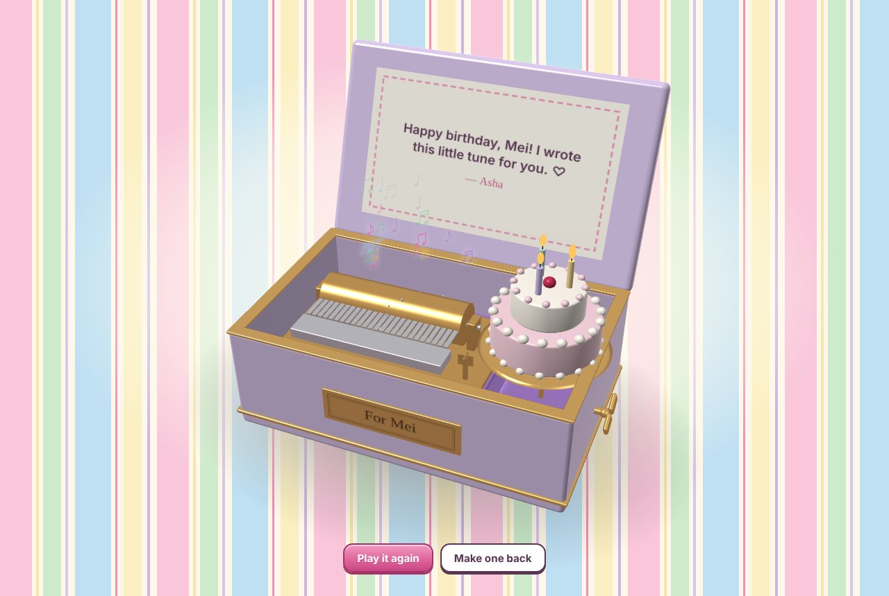

# Music Box Studio

Compose a little melody on a music box, watch it play in 3D, and send it to someone as a gift.



| It arrives sealed… | …the box waits under a spotlight… | …and plays when you turn the key |
|---|---|---|
|  |  |  |

## What it does

- **Compose on a punched paper strip,** like the ones real hand-crank music boxes use. It has 25 rows, one for each tooth of the comb (C4 to C6). Click to punch a hole, drag to punch several, and use Undo or the keyboard (arrow keys + Enter).
- **Watch it play in 3D.** The brass cylinder turns, the pins you placed pluck the steel teeth, the little air-brake fan spins and the key turns. Drag to rotate, scroll or pinch to zoom.
- **Hear a real music box sound,** made from scratch in the browser. There are no audio files: each note is a plucked steel tooth with its own overtones, a tiny metallic click and a small wooden-box reverb.
- **Make it a gift.** Choose a finish: seven colours, or eight patterns wrapped round the box (rainbow swirl, pink swirl, floral quilt, red croc, pink mosaic, painted tiles, blossom and berry stripe), engrave a name on the gold plate and write a note inside the lid.
- **Add a twirling figure:** a ballerina, a swan, a carousel horse, a rose under a glass dome, or a birthday cake with flickering candles. It pops up on a gold spring as the lid opens and turns in time with the music, slowing down when the music winds down.
- **Share a link.** The whole song and message are packed into the link itself (about 200–400 characters), so there's **no database and no sign-up**.
- **Opening the gift is a small ceremony:**
  - It arrives as a baby-blue envelope sealed with pink wax, stamped with the sender's initial.
  - Breaking the seal reveals the box, with a pulsing ring showing where to turn the key.
  - The lid opens, the figure pops up, and little pastel notes drift up from the comb with every note. The tune plays twice and slows down at the end, like a real spring running out.
  - **Make one back** opens the studio with the same tune, ready to change.
- **Link previews:** pasting the link into WhatsApp, Instagram or iMessage shows a picture of the box and "A music box, made for you".
- **Starter tunes in the public domain:** *Twinkle, Twinkle*, *Ode to Joy*, *Für Elise* and *Happy Birthday*.
- **Your work is saved** in your browser, so it's still there after a refresh.

## How it's built

No frameworks and no dependencies, just HTML, CSS and JavaScript modules.

| File | What it does |
|---|---|
| `js/gl.js` | A **hand-written WebGL 2 renderer**: matrix maths, shape builders (rounded boxes, cylinders, spheres, lathe shapes), merging many shapes into one draw call, and a shader with soft "photo studio" lighting for glossy lacquer, polished metal and velvet. |
| `js/box3d.js` | The 3D music box scene: body, hinged lid, engraved plate and lid note (drawn with a 2D canvas, then used as textures), the pinned cylinder built from the song, the comb with teeth that spring back after each pin, orbit camera, and picking (clicking the key or lid). |
| `assets/finishes/` | The pictures used for patterned finishes, repeated across each face of the box by the shader. |
| `js/figures.js` | The twirling porcelain figures, built from spheres, rods and **lathe-turned** shapes (profiles spun around an axis, like turning wood). |
| `js/audio.js` | The music box sound with the **Web Audio API**: synthesised plucks, a look-ahead scheduler for steady timing, the wind-down at the end, and offline rendering to a sound file. |
| `js/song.js` | The song + gift data and the **share-link format** (packed into bytes, then base64url). |
| `js/grid.js` | The note grid (canvas), with mouse, touch and keyboard editing. |
| `js/tunes.js` | Starter tunes written in a tiny text notation. |
| `js/app.js` | Wires the studio and the gift view together. |

**Some details I'm proud of:**
- **Pins:** the cylinder's pins are generated from the song, all merged into a single mesh. Each pin's angle is set so it reaches the comb exactly when its note plays.
- **Shapes:** triangles are automatically checked to face outwards, so every generated shape renders correctly with back-face culling.
- **Link versions:** share links carry a format version, so links made before figures existed still open correctly.
- **Accessibility:** the grid works with the keyboard and announces changes to screen readers, the finish picker uses arrow keys, and animations respect "reduce motion".

## Design

Pastel stationery: butter-yellow paper scattered with stars, a melody strip in yellow and baby-blue rows held by a pink binder bar, a pink gift tag with a stitched edge, and finish choices shaped like sewing buttons. The gift opens on hand-drawn pastel stripes. Headings, names and engravings use the rounded *Fredoka*; everything else uses *Nunito*. Both stay easy to read in capitals and lowercase.

## Run it

It's a static site, but browsers only load JavaScript modules from a web server, not by double-clicking `index.html`. Either:

- **VS Code:** install the **Live Server** extension, right-click `index.html` → **Open with Live Server**, or
- **Terminal:** `python -m http.server 8080`, then open http://localhost:8080

## Deploy (free)

**GitHub Pages:** push the repo, then go to **Settings → Pages → Source: Deploy from a branch → `main` / root → Save**. Your site will be at `https://YOUR-USERNAME.github.io/REPO-NAME/` a minute later. Vercel and Netlify also work, with no build step.

After deploying, open `index.html` and change `og:image` to the full address of the preview picture (e.g. `https://YOUR-USERNAME.github.io/REPO-NAME/og-image.jpg`). Most chat apps only show previews for full addresses.

## Tests

```bash
npm test               # unit tests: notes, lengths, starter tunes, share links, old and broken links
python tests/e2e.py    # browser test (needs Playwright + a local server on port 8099)
```

The browser test composes a tune with the mouse and keyboard, plays and stops it, picks a figure, creates a gift link and reloads. It then opens the link as the recipient: breaks the seal, checks the key ring, turns the key, and checks that the box plays and the note appears.

## Ideas for next

- Import a MIDI file and fit it to the 25 teeth
- Export a printable paper strip for real 15- and 30-note hand-crank music boxes
- A public gallery of music boxes (with a small database)

## Credits

Everything here (3D, sound, graphics) is made from scratch. Starter melodies are traditional or by Beethoven and are in the public domain. Fonts: [Fredoka](https://fonts.google.com/specimen/Fredoka) and [Nunito](https://fonts.google.com/specimen/Nunito) (SIL Open Font License).

**Pattern finishes** in `assets/finishes/` are reference pictures used for this prototype. Before publishing widely, replace them with patterns you made or have permission to use; a finish is just a picture plus one line in `BOX_COLORS` in `js/song.js`.
